# Coldberry Ice Cream Nigeria — System Architecture & Infrastructure Log

This document details how every component, page, script, API handler, database integration, and stylesheet in the Coldberry Ice Cream Nigeria web platform connects, communicates, and scales across devices and backend services.

---

## 1. High-Level System Connection Diagram

```mermaid
flowchart TD
    subgraph ClientPages["Customer Facing HTML Pages (Port 3000)"]
        P_HOME["index.html<br/>(Home & Preview + Nav Cart)"]
        P_MENU["890b.html<br/>(Full Menu + 2-in-1 Tub Split + Nav Cart)"]
        P_DEALS["pizzadeals.html<br/>(Combos & Tub Deals + Nav Cart)"]
        P_ORDER["order.html<br/>(50/50 Fulfilment, Branch Routing & PIN)"]
        P_TRACK["track.html<br/>(Micro-Stepper Live Tracking & Cancel)"]
        P_LOGIN["login.html<br/>(Customer Auth & 6-Region Phone Picker)"]
        P_FEEDBACK["feedback.html<br/>(Customer Feedback Portal)"]
        P_REFUNDS["refunds.html<br/>(Customer Refund Tokens)"]
        P_PRIVACY["privacy.html<br/>(NDPA 2023 Policy)"]
        P_TERMS["terms.html<br/>(Terms & Conditions)"]
    end

    subgraph OperationConsoles["Role-Locked Operation Consoles (Port 4000 & 4001)"]
        C_ADMIN_SRV["admin-console/server.js<br/>(Standalone Admin Host + Proxy)"]
        C_ADMIN_UI["admin-console/index.html & admin.html<br/>(Locked 14-Char Login · Admin vs Staff RBAC)"]
        C_DRIVER_SRV["driver-console/server.js<br/>(Standalone Rider Host)"]
        C_DRIVER_UI["driver-console/index.html & driver.html<br/>(Rider Dispatch · Google Maps & WA Direct)"]
    end

    subgraph Styles["Global Stylesheet & Mobile Shield"]
        CSS["peter890.css<br/>• Viewport Shield (320px–768px)<br/>• Safe-Area Inset Handling<br/>• Fluid Typography & Touch Targets<br/>• Light/Dark Theme Tokens"]
    end

    subgraph ClientJS["Client-Side Script Layer (js/)"]
        JS_SITE["js/site.js<br/>• Live Search Filter<br/>• ThemeController (Light/Dark)<br/>• Cross-Tab Theme Sync"]
        JS_CART["js/cart.js<br/>• Global Cart Sync<br/>• Counter Badges<br/>• Quantity Control (1–10)"]
        JS_DEALS["js/deals-interactive.js<br/>• Tub Flavour Pull-Downs<br/>• Half & Half 2-in-1 Split Engine<br/>• Deal Combo Builder"]
        JS_ORDER["js/order.js<br/>• Pricing Engine & ITEM_PRICES<br/>• ₦800 Service Fee<br/>• 15% Delivery Fee<br/>• Dynamic Branch WhatsApp Routing"]
        JS_FB["js/feedback-bubble.js<br/>• Floating Feedback Widget<br/>• Star Rating & Complaint Mode<br/>• Cart Clearance (calc(5.25rem + safe-area))<br/>• Dual-DB Sync Client"]
    end

    subgraph BrowserStorage["Browser Client State"]
        STORAGE_CART["localStorage['romeos_cart']"]
        STORAGE_THEME["localStorage['romeos-theme']"]
        STORAGE_PIN["localStorage['romeos_last_order_pin']"]
        BC_CART["BroadcastChannel<br/>('romeos_cart_channel')"]
        BC_THEME["BroadcastChannel<br/>('romeos_theme_channel')"]
    end

    subgraph ServerLayer["Backend API Layer (api/ & Server)"]
        DEV_SERVER["dev-server.js<br/>(Local Node HTTP Server on Port 3000)<br/>• Path Traversal Guard<br/>• Zero Hard-Coded Secrets"]
        API_ORDERS["api/orders.js<br/>• Validates & Normalizes<br/>• Branch-Specific WA Routing<br/>• 6-Digit Atomic PIN"]
        API_TRACK["api/track.js<br/>• Live Order Tracking<br/>• 12-Min Cancellation<br/>• 15-Char Refund Tokens"]
        API_AUTH["api/auth.js<br/>• Customer Registration & Login<br/>• HttpOnly Cookie Sessions<br/>• Active Session Store"]
        API_FEEDBACK["api/feedback.js<br/>• Dual-DB Synchronization<br/>• Rating Validation & Complaint Tagging"]
        API_ADMIN["api/admin.js<br/>• 14-Char Timing-Safe RBAC<br/>• Broadcast Campaigns<br/>• Account & Token Deletion"]
        API_PIN["api/pin-manager.js<br/>• 5-Day Non-Recycling Retention"]
        API_DB["api/db.js<br/>• Supabase & Neon Client<br/>• Local Store Fallback"]
        PRICES_JSON["prices.json<br/>(Single Source of Truth)"]
    end

    subgraph ExternalServices["External Endpoints & Cloud Infrastructure"]
        WA_BRANCH["Branch WhatsApp Chat<br/>(Garki, Lugbe, Yaba, Surulere, etc.)"]
        DB_NEON["Neon Serverless PostgreSQL<br/>• orders<br/>• order_pins<br/>• customer_feedback"]
        DB_SUPABASE["Supabase REST API<br/>• orders<br/>• customer_feedback"]
        GMAPS["Google Maps Navigation<br/>(Turn-by-Turn Delivery Route)"]
    end

    %% Stylesheet connections
    P_HOME --> CSS
    P_MENU --> CSS
    P_DEALS --> CSS
    P_ORDER --> CSS
    P_TRACK --> CSS
    P_LOGIN --> CSS
    P_FEEDBACK --> CSS
    P_REFUNDS --> CSS
    P_PRIVACY --> CSS
    P_TERMS --> CSS
    C_DRIVER_UI --> CSS

    %% Page Script bindings
    P_HOME --> JS_SITE
    P_HOME --> JS_CART
    P_HOME --> JS_FB

    P_MENU --> JS_SITE
    P_MENU --> JS_CART
    P_MENU --> JS_DEALS
    P_MENU --> JS_FB

    P_DEALS --> JS_SITE
    P_DEALS --> JS_CART
    P_DEALS --> JS_DEALS
    P_DEALS --> JS_FB

    P_ORDER --> JS_SITE
    P_ORDER --> JS_CART
    P_ORDER --> JS_ORDER
    P_ORDER --> JS_FB

    P_TRACK --> JS_SITE
    P_TRACK --> JS_FB

    P_LOGIN --> JS_SITE
    P_LOGIN --> JS_FB

    %% Cross-script dependencies
    JS_DEALS -.->|reads pricing| JS_ORDER
    JS_ORDER -.->|mirrors state| JS_CART

    %% Browser state connections
    JS_SITE <--> STORAGE_THEME
    JS_SITE <--> BC_THEME
    JS_CART <--> STORAGE_CART
    JS_CART <--> BC_CART

    %% API connections
    P_ORDER --"POST /api/orders"--> API_ORDERS
    P_TRACK --"GET/POST /api/track"--> API_TRACK
    P_LOGIN --"POST /api/auth"--> API_AUTH
    JS_FB --"POST /api/feedback"--> API_FEEDBACK
    C_ADMIN_UI --"POST/PATCH/DELETE /api/admin"--> API_ADMIN
    C_DRIVER_UI --"GET /api/orders (delivery-only)"--> API_ORDERS

    API_ORDERS --> API_DB
    API_TRACK --> API_DB
    API_ADMIN --> API_DB
    API_FEEDBACK --> DB_NEON
    API_FEEDBACK --> DB_SUPABASE

    %% External handoffs
    API_ORDERS --"returns branch wa.me URL"--> P_ORDER
    P_ORDER --"window.open"--> WA_BRANCH
    C_DRIVER_UI --"1-tap navigate"--> GMAPS
    C_DRIVER_UI --"1-tap courier chat"--> WA_BRANCH
```



---

## 2. Interactive Data Flows

### Flow A: Multi-Page Cart & Cross-Tab Synchronization
```
[User clicks '+' or '−' button on any page]
    │
    ▼
[DOM Event Listener in js/cart.js or js/order.js]
    │
    ├── 1. Updates in-memory cart object (quantities clamped 1–10)
    ├── 2. Writes to localStorage['romeos_cart'] (JSON array: [{name, quantity}])
    ├── 3. Writes to localStorage['romeos-pizza-cart'] (Legacy map: {name: quantity})
    ├── 4. Broadcasts message on BroadcastChannel('romeos_cart_channel')
    └── 5. Dispatches CustomEvent('cart:change') on document
            │
            ▼
[All open browser tabs & pages catch the broadcast]
    ├── Updates cart badge (#cart-count) in header
    ├── Updates addon card styles (.checkout-addon-card.is-in-cart)
    └── On order.html: recalculates subtotal, fees, and grand total in real time
```

---

### Flow B: Deals & Dynamic Pizza Size Selection
```
[User visits pizzadeals.html or 890b.html]
    │
    ├── Deals Combos:
    │     User changes 'Pizza 1' or 'Pizza 2' pull-down select
    │     ├── js/deals-interactive.js resolves composite name:
    │     │   e.g., "The Festive Box (Pepperoni Pizza + BBQ Chicken Pizza)"
    │     ├── Updates quantity control data-cart-item attribute
    │     └── Reads current cart quantity for that exact composite selection
    │
    └── Individual Menu Pizzas:
          User selects size (Medium 10" / Large 12" / Champion 16")
          ├── js/deals-interactive.js maps pizza to category (Traditional, Special, Exclusive)
          ├── Resolves live price from PIZZA_PRICES dictionary
          ├── Updates visible price tag (e.g., "₦14,150")
          └── Updates data-cart-item to "Pizza Name (Size)"
```

---

### Flow C: Checkout, Pricing Calculation & WhatsApp Order Dispatch
```
[User fills checkout form on order.html and clicks 'Continue to WhatsApp']
    │
    ├── 1. Client-side Validation (js/order.js):
    │     • Name length >= 2 chars
    │     • Phone number valid Nigerian format (normalized to E.164: +234...)
    │     • Delivery address length >= 5 chars (waived for Pickup)
    │     • Location selected from valid list
    │     • Mandatory legal consent checked (terms.html & privacy.html)
    │     • At least 1 item in cart or custom items text entered
    │
    ├── 2. Pricing Engine Execution (calculateOrderTotals):
    │     • Subtotal: sum(item_price * quantity)
    │     • Service Fee: flat ₦800 (if item count > 0)
    │     • Delivery Fee: Math.round(subtotal * 0.15) if Delivery; ₦0 for Pickup
    │     • Grand Total: subtotal + serviceFee + deliveryFee
    │     • NOTE: The 15% formula is hidden; customer sees only the exact Naira amount
    │
    ├── 3. Pre-opens blank tab synchronously (avoids Safari/Chrome popup blockers)
    │
    ├── 4. Async Dispatch to Serverless API:
    │     POST /api/orders
    │     ├── api/orders.js re-validates payload server-side
    │     ├── Calculates pricing using calculateOrderTotals() from js/order.js
    │     ├── Formats structured WhatsApp Markdown message
    │     ├── Asynchronously stores record via api/db.js (Supabase / Neon)
    │     └── Returns { whatsappUrl: "https://wa.me/2349055303848?text=...", orderId, pricing }
    │
    ├── 5. Browser redirects pre-opened tab to whatsappUrl
    │
    └── 6. Confirmation Screen on order.html displays itemized receipt, order ref,
          fallback clickable link, and an 'Edit Order' button to return if needed
```

---

### Flow D: Theme Controller (Dark / Light Mode)
```
[User clicks #theme-toggle button in navigation]
    │
    ▼
[ThemeController.toggleTheme() in js/site.js]
    │
    ├── 1. Toggles data-theme attribute on <html> element: 'dark' <-> 'light'
    ├── 2. Updates <meta name="theme-color"> (#161114 for dark, #5C1A2B for light)
    ├── 3. Updates aria-pressed and toggles icon class (fa-moon <-> fa-sun)
    ├── 4. Persists setting in localStorage['romeos-theme']
    ├── 5. Broadcasts across tabs via BroadcastChannel('romeos_theme_channel')
    └── 6. peter890.css re-renders colors via CSS custom properties
```

---

## 3. Component & File Connection Matrix

| File Path | Role | Inbound Connections (Who calls/includes it) | Outbound Connections (What it calls/uses) |
| :--- | :--- | :--- | :--- |
| **`index.html`** | Landing page & quick preview | Direct visitor entry, nav links from all pages | `peter890.css`, `js/site.js`, `js/cart.js`, `js/feedback-bubble.js`, `images/`, `890b.html`, `pizzadeals.html`, `order.html`, `privacy.html`, `terms.html` |
| **`890b.html`** | Full menu with tubs, scoops, toppings, drinks & deals | Links from `index.html`, `order.html`, footers | `peter890.css`, `js/site.js`, `js/cart.js`, `js/deals-interactive.js`, `js/feedback-bubble.js`, `order.html?item=...`, `privacy.html`, `terms.html` |
| **`pizzadeals.html`** | Deals & combos with interactive flavor pickers | Links from `index.html`, `890b.html`, footers | `peter890.css`, `js/site.js`, `js/cart.js`, `js/deals-interactive.js`, `js/feedback-bubble.js`, `privacy.html`, `terms.html` |
| **`order.html`** | 50/50 live cart, sides addons, and checkout form | Links from `index.html`, `890b.html`, `pizzadeals.html` | `peter890.css`, `js/site.js`, `js/cart.js`, `js/order.js`, `js/feedback-bubble.js`, `api/orders.js`, `track.html`, `privacy.html`, `terms.html` |
| **`track.html`** | Customer order tracking by Phone + 6-digit PIN | Nav/footer links from all pages, order confirmation link | `peter890.css`, `js/site.js`, `js/feedback-bubble.js`, `api/track.js`, `privacy.html`, `terms.html` |
| **`login.html`** | Customer accounts & 6-region phone selector | Navbar profile icon, account links | `peter890.css`, `js/site.js`, `js/feedback-bubble.js`, `api/auth.js`, `privacy.html`, `terms.html` |
| **`driver.html`** | Dedicated Rider & Delivery Driver Console | Standalone rider dispatch interface (`/driver`) | `peter890.css`, `api/orders.js` (delivery-only), Google Maps URL, WhatsApp Direct |
| **`driver-console/`**| Standalone hostable Driver Console | Run via `driver-console/server.js` | Dedicated rider server on port 4001, proxies to main API |
| **`admin.html`** | Store Manager Verification Console | Staff & manager login link | `peter890.css`, `api/admin.js`, 14-char RBAC verification |
| **`admin-console/`** | Separately hosted locked Verification Console | Run via `npm run start:console` or standalone Vercel deploy | Serves locked 14-char login UI on port 4000, proxies/calls `/api/admin` |
| **`feedback.html`** | Customer feedback & scoop complaint portal | Footer and floating bubble links | `peter890.css`, `api/feedback.js`, Neon + Supabase dual-sync |
| **`refunds.html`** | Customer refund token claim & verification page | Linked from order cancellation notices | `peter890.css`, `api/auth.js`, `api/track.js` |
| **`privacy.html`** | NDPA 2023 legal privacy policy | Footers of all pages, checkout consent link | `peter890.css`, `js/site.js`, `js/cart.js`, `terms.html` |
| **`terms.html`** | Terms & Conditions (cancellations, fees) | Footers of all pages, checkout consent link | `peter890.css`, `js/site.js`, `js/cart.js`, `privacy.html` |
| **`peter890.css`** | Unified stylesheet & mobile responsive shield | Included in `<head>` by all HTML pages | Viewport rules (320px–768px), safe areas, CSS custom properties |
| **`prices.json`** | Canonical Single Source of Truth for pricing | Consulted by pricing engines & test suites | 4 tiers, 3 sizes, combos, sides/drinks, fee constants |
| **`js/site.js`** | Search filtering & ThemeController | Included via `<script defer>` on customer pages | `localStorage['romeos-theme']`, `BroadcastChannel('romeos_theme_channel')` |
| **`js/cart.js`** | Multi-page cart state & counter manager | Included via `<script defer>` on customer pages | `localStorage['romeos_cart']`, `BroadcastChannel('romeos_cart_channel')` |
| **`js/deals-interactive.js`**| Deals & tub pull-down selectors, Half & Half visual preview | Included on `890b.html` and `pizzadeals.html` | `window.RomeosCart`, `js/order.js`, `localStorage` |
| **`js/order.js`** | Checkout engine, pricing formula & branch routing | Included on `order.html`, imported by `api/orders.js` | `window.RomeosCart`, `/api/orders`, branch WhatsApp numbers |
| **`js/feedback-bubble.js`**| Floating feedback widget with sticky cart collision clearance | Included via `<script defer>` on all customer pages | Elevates to `calc(5.25rem + safe-area)` when `.menu-cart` is mounted; calls `/api/feedback` |
| **`api/orders.js`** | Serverless order validation & branch routing endpoint | Called via `POST` & `GET` by `order.html` & dev-server | `js/order.js`, `api/pin-manager.js`, `api/db.js` |
| **`api/track.js`** | Serverless tracking & 12-min cancel API | Called via `GET`/`POST`/`DELETE` by `track.html` & `order.html` | `api/db.js`, 15-char refund token generation, 12-min cancellation |
| **`api/feedback.js`**| Dual-DB feedback API (Neon + Supabase) | Called via `GET`/`POST`/`OPTIONS` by feedback widgets | Writes simultaneously to Neon Postgres and Supabase |
| **`api/auth.js`** | Customer authentication & cookie session API | Called by `login.html` | User registration, password verification, HttpOnly session cookies |
| **`api/pin-manager.js`** | 6-digit random Order PIN generator | Required by `api/orders.js` | Enforces 5-day non-recycling retention via atomic DB allocation or memory |
| **`api/db.js`** | Multi-driver database abstraction & local store | Imported by `api/orders.js`, `api/track.js`, `api/admin.js` | Supabase REST API, Neon PostgreSQL, local `/tmp/romeos-orders-store.json` fallback |
| **`api/admin.js`** | RBAC Console API (POST login, GET, PATCH, DELETE) | Called by `admin-console/` & `admin.html` with CORS | Timing-safe 14-char auth, HMAC tokens, PII masking, broadcast campaigns |
| **`dev-server.js`** | Zero-dependency local development server | Run via `npm start` or `node dev-server.js` | Serves static files, path traversal guard, routes all `/api/*` endpoints |
| **`scripts/verify-all.js`** | Automated 103-test regression suite | Run via `npm test` or `node scripts/verify-all.js` | Tests all HTML, JS, CSS, branch routing, rider console, customer auth, refund tokens |
| **`scripts/test-feedback-feature.js`** | 15-test dual-DB feedback suite | Run via `node scripts/test-feedback-feature.js` | Tests schema, dual insertion, validation, CORS, and bubble script integration |

---

## 4. Fee & Pricing Formula Specifications

All prices and calculations are standardized across client and server:

* **Subtotal**: Sum of `item_price × quantity` for all cart items.
* **Service Fee**: Flat **₦800** when cart item count > 0; ₦0 for empty carts.
* **Delivery Fee**: **15%** of subtotal (`Math.round(subtotal * 0.15)`) for Delivery orders; **₦0 (Free Pickup)** for Pickup orders.
  * *UI Disclosure Rule*: The percentage formula (`15%`) is strictly internal and never shown in customer receipts or UI. Only the exact calculated Naira amount (e.g. `Delivery Fee: ₦2,123`) is displayed.
* **Grand Total**: `Subtotal + Service Fee + Delivery Fee`.
* **Branch WhatsApp Routing**:
  * Abuja Garki: `2349055303848`
  * Abuja Lugbe: `2349055303849`
  * Lagos Yaba: `2348023456701`
  * Lagos Surulere: `2348023456702`
  * Lagos Okota: `2348023456703`
  * Lagos Festac: `2348023456704`
  * Lagos Ajao: `2348023456705`

---

## 5. Mobile Responsive Infrastructure & Viewport Architecture (320px – 768px)

The platform implements a multi-layer mobile responsiveness architecture designed for high durability across modern and legacy smart devices:

### A. Universal Viewport Configuration (`viewport-fit=cover`)
All 10 HTML documents declare:
```html
<meta name="viewport" content="width=device-width, initial-scale=1.0, viewport-fit=cover" />
```
- Eliminates letterboxing on iPhone Dynamic Island and Android edge-to-edge displays.
- Complies strictly with **WCAG 1.4.4 (Resize Text)** by allowing user zooming up to 200%+.

### B. Safe-Area Inset Handling
Uses CSS environment variables:
- Sticky bottom cart bar (`.menu-cart`): `padding-bottom: calc(0.65rem + env(safe-area-inset-bottom, 0px))`
- Global body margins: `padding-left: env(safe-area-inset-left, 0px); padding-right: env(safe-area-inset-right, 0px)`
- Floating Feedback trigger: `bottom: calc(1.5rem + env(safe-area-inset-bottom, 0px))`

### C. Sticky Cart Collision Avoidance
When `.menu-cart` is mounted on the page:
```css
body.has-menu-cart #romeos-feedback-bubble-root,
body:has(.menu-cart) #romeos-feedback-bubble-root {
  bottom: calc(5.25rem + env(safe-area-inset-bottom, 0px));
}
```
Elevates the trigger bubble cleanly above the bottom checkout bar, guaranteeing checkout CTAs remain unobstructed.

### D. Stepper Micro-Rules across Compact Viewports
- **$\le 480\text{px}$**: Step circles scale to $32\text{px}$, labels to $0.65\text{rem}$ with line margins shrinking.
- **$\le 360\text{px}$ (e.g. Galaxy Fold / iPhone SE 1st gen)**: Step circles scale to $26\text{px}$, labels to $0.58\text{rem}$, and connecting lines dynamically shrink to fit within 280px available width.

### E. Touch Targets & iOS Zoom Prevention
- All tappable controls (`button`, `a`, `select`, `input`) enforce a minimum touch target of $\ge 44 \times 44\text{px}$.
- Inputs on $\le 480\text{px}$ enforce `font-size: 16px` to prevent automatic zoom behavior on iOS Safari.

---

## 6. Verification & Testing

To verify that all connections, files, endpoints, fee logic, and legal requirements remain in working order:

```bash
npm test
# Or: node scripts/verify-all.js && node scripts/test-feedback-feature.js
```

All 103 automated checks test syntax, assets, sizing, pricing engines, navbar cart icon, API endpoints, RBAC auth, 12-minute cancel window, rider console, customer auth, refund tokens, and legal compliance.
The 15 feedback checks validate dual-DB schema, CORS, review insertions, retrieval, and bubble script integration.

To run the 5-round adversarial stress testing suite:

```bash
node scripts/stress-test.js
```
